# Keybird

<p align="center">
  
</p>

<p align="center">
  <a href="https://github.com/iplus009/iplus-keboard/releases/latest">
    
  </a>
  <a href="https://github.com/iplus009/iplus-keboard/releases">
    
  </a>
</p>

**Keybird** (formerly *iPlus Keyboard*) is an Android keyboard project focused on Bangla and English input, a customizable typing experience, and a clean app-facing interface built on top of the open-source keyboard engine while preserving upstream licensing and attribution.

> **Download:** Get the latest universal Android APK (`Keybird-v2.0.4.apk` via CI release) from **[Releases (Latest APK)](https://github.com/iplus009/iplus-keboard/releases/latest)** or browse all builds on the **[Releases page](https://github.com/iplus009/iplus-keboard/releases)**.
>
> **Development status:** Universal APK builds are generated via GitHub Actions. Physical-device regression testing is ongoing.

## Project at a glance

| Item | Details |
|---|---|
| Platform | Android (API 24–35) |
| App name | Keybird |
| Version | `v2.0.4` (`versionCode 20004`) |
| Main input focus | Bangla and English |
| Source branch | `main` |
| Application ID | `com.iplus.keyboard` (retained for compatibility) |
| Build channel | GitHub Actions — stable debug universal APK |
| Official Telegram | [@ismailq01appsstore](https://t.me/ismailq01appsstore) |

## What makes Keybird different

| Experience area | Typical stock / generic keyboards | Keybird |
|---|---|---|
| **Signature visual style** | Uniform monochrome rectangles | **Keybird Matte** (Bauhaus color-block palette + dot-matrix key legends) alongside **Nothing / AMOLED**, **Emerald**, **Cotton Candy**, and **Material You** presets across `20` theme modes |
| **Action strip footprint** | Stacked double toolbars eating screen height | **Single `40dp` inline ActionBar** — tap `>` / `<` to swap inline between suggestions and customizable shortcuts, plus **`...` All Actions** drawer (`Translate`, `Voice Input`, `Text Editor`, `Clipboard`, `Undo/Redo`, `Cut/Copy/Paste`) |
| **Voice typing** | Fixed system-only dictation popup | **Mixed Bangla + English Voice Input** with **Live transcription**, **Voice punctuation**, Bluetooth mic preference, offline Whisper support, and `Use Device Voice` fallback |
| **Inline translator** | Requires leaving app or switching keyboards | **Built-in Translator** right inside the keyboard with **Auto Detect**, one-tap **`Bn ⇄ En`** toggle, language swap (`⇄`), and direct insert |
| **Precision editing & clipboard** | Basic cursor drag on spacebar | **Full Text Editor** pad (4-way directional arrows, Shift-Select, Select Word/All, Copy/Paste, Undo/Redo) + **Clipboard Manager** (`50` items / `7` days, password/sensitive-text exclusion) |
| **Portrait comfort height** | Frequently clamped too short (`~243dp`) on tall phones | **Option B ergonomic height** (`292.0dp` default key grid, `55%p` cap) tuned for ~5.2–5.5 cm two-thumb reach |
| **Bangla typing depth** | Usually phonetic-only or 1 fixed layout | **4 built-in Bangla layouts** (`Avro (অভ্র)`, `Probhat (প্রভাত)`, `Jatiyo (জাতীয়)`, and alphabetical `Bangla (বাংলা)`) + `English` — up to **5 active subtypes** switchable right from the spacebar |
| **One-Handed ergonomics** | Basic shrink-to-side box | Dedicated opposite-side **control rail** (`18%` width) with one-tap **Swap Left/Right** and **Expand Full Width**, synced with Split Keyboard |
| **Custom photo personalization** | Simple image overlay that washes out keys | Live **Dim (`0–85%`)**, **Zoom (`1.0x–2.5x`)**, **X/Y pan**, **softening blur (`0–20`)**, **light/dark contrast switch**, and **named reusable presets** |
| **Settings & privacy UX** | Cluttered flat preferences + cloud trackers | **Nothing-inspired dot-matrix UI** with an instant **"Try typing here..."** playground, Banglish auto-correct guardrails, and no third-party ad SDKs |

## Theme showcase

Captured directly from `Keybird v2.0.4` (`com.iplus.keyboard`) on Android emulator (`avro26`, API 26):

<table>
  <tr>
    <td align="center" width="25%">
      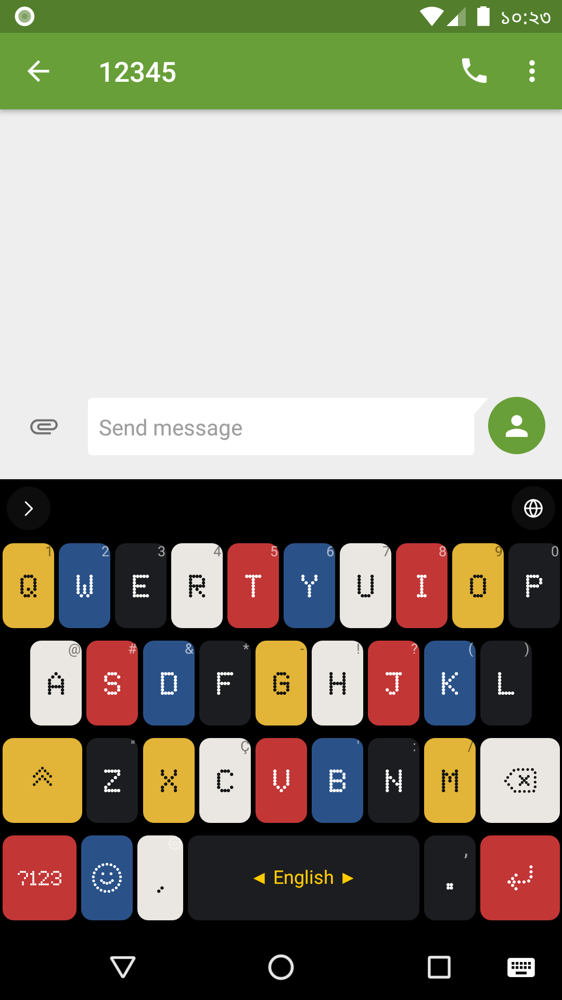
      <br />
      <b>Keybird Matte</b><br />
      <sub>Bauhaus color-block & dot-matrix legends</sub>
    </td>
    <td align="center" width="25%">
      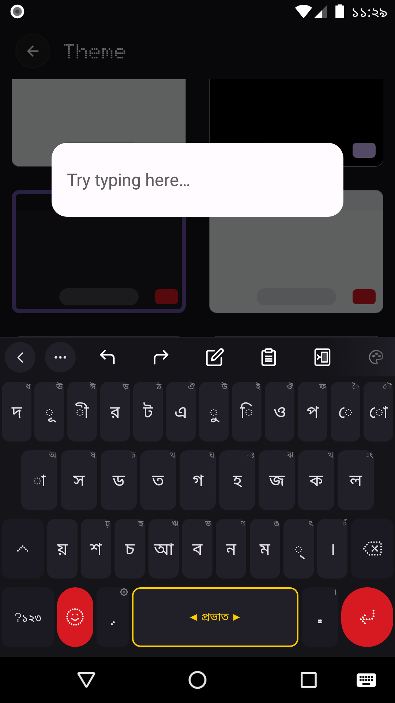
      <br />
      <b>AMOLED Nothing</b><br />
      <sub>True black surface & crimson accents</sub>
    </td>
    <td align="center" width="25%">
      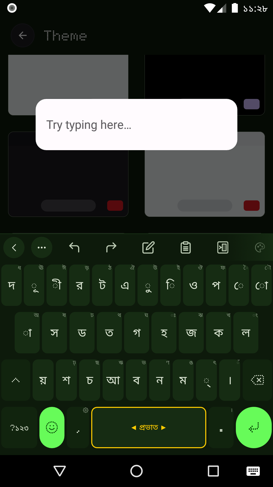
      <br />
      <b>Emerald</b><br />
      <sub>Deep forest palette & neon green keys</sub>
    </td>
    <td align="center" width="25%">
      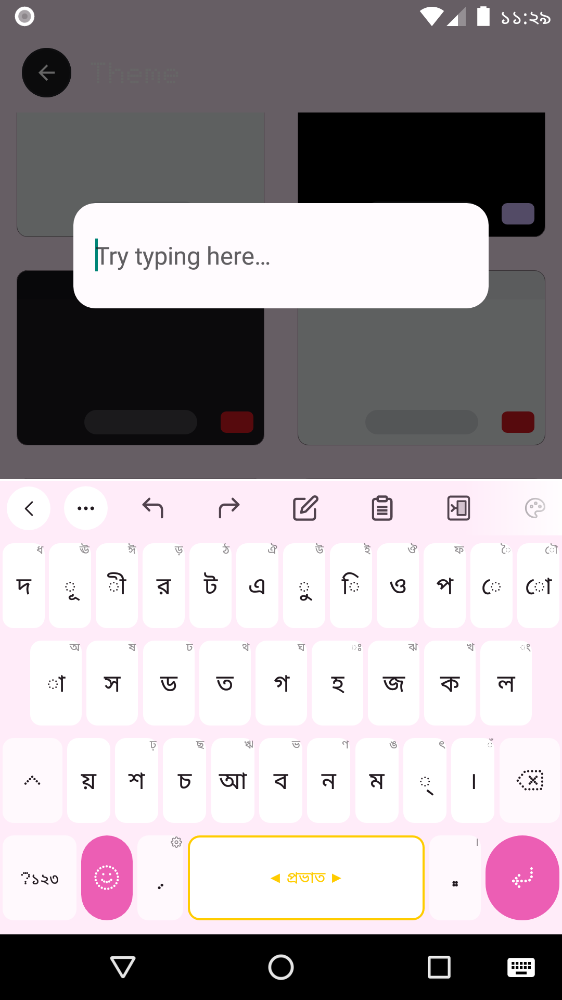
      <br />
      <b>Cotton Candy</b><br />
      <sub>Crisp light pastel contrast & rose accents</sub>
    </td>
  </tr>
</table>

<details>
<summary><b>View Theme Picker Gallery &amp; all 20 built-in / custom theme modes</b></summary>
<br />
<p align="center">
  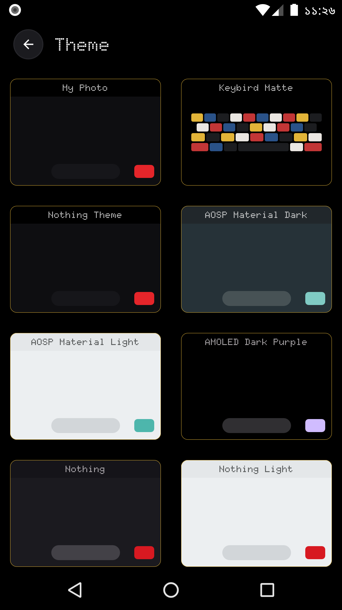
</p>

- **Signature & Custom:** `My Photo` (`CustomPhotoTheme`), `Keybird Matte` (`IPlusMatteTheme`), `VoiceInputTheme`
- **Adaptive / Material You:** `DynamicNothing`, `DynamicSystemTheme`, `DynamicDarkTheme`, `DynamicLightTheme`
- **Dark & AMOLED:** `AMOLEDNothing`, `AMOLEDDarkPurple`, `NothingDark`, `ClassicMaterialDark`, `DeepSeaDark`, `Emerald`
- **Light & Pastel:** `NothingLight`, `ClassicMaterialLight`, `Sunflower`, `Snowfall`, `SteelGray`, `CottonCandy`, `DeepSeaLight`

</details>

## Feature samples in action

<table>
  <tr>
    <td align="center" width="25%">
      
      <br />
      <b>Inline ActionBar</b><br />
      <sub>Expands tools inside the same 40dp bar</sub>
    </td>
    <td align="center" width="25%">
      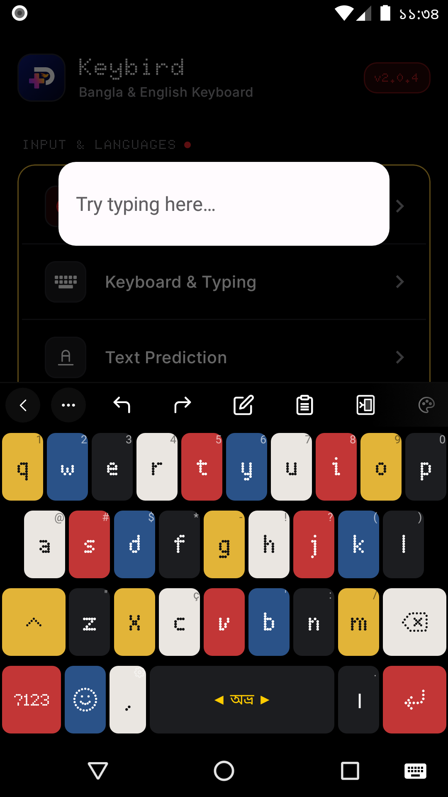
      <br />
      <b>Avro Phonetic (অভ্র)</b><br />
      <sub>Spacebar swipe/arrows switch up to 5 subtypes</sub>
    </td>
    <td align="center" width="25%">
      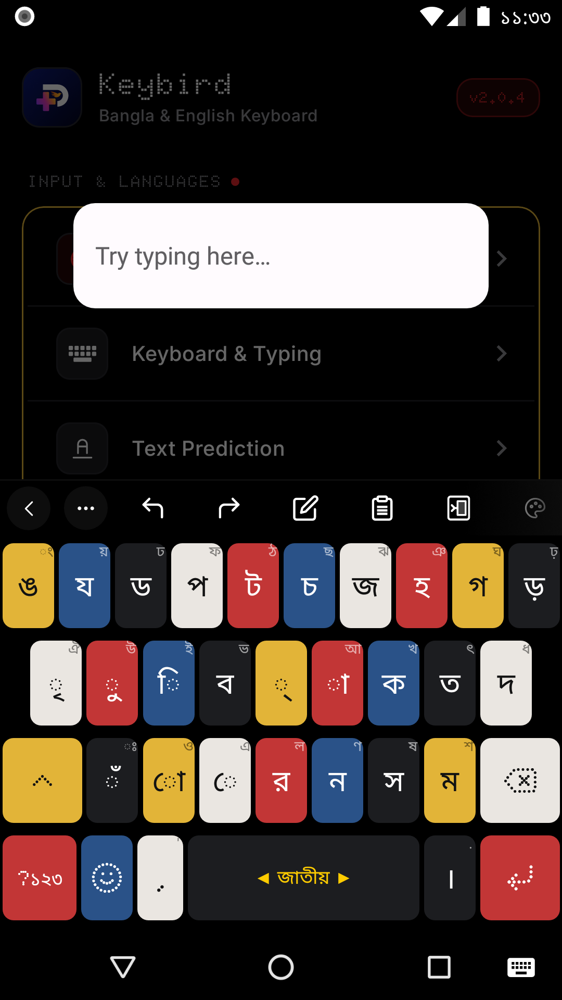
      <br />
      <b>4 Bangla Layouts</b><br />
      <sub>Avro, Probhat, Jatiyo &amp; Bangla Alphabetical</sub>
    </td>
    <td align="center" width="25%">
      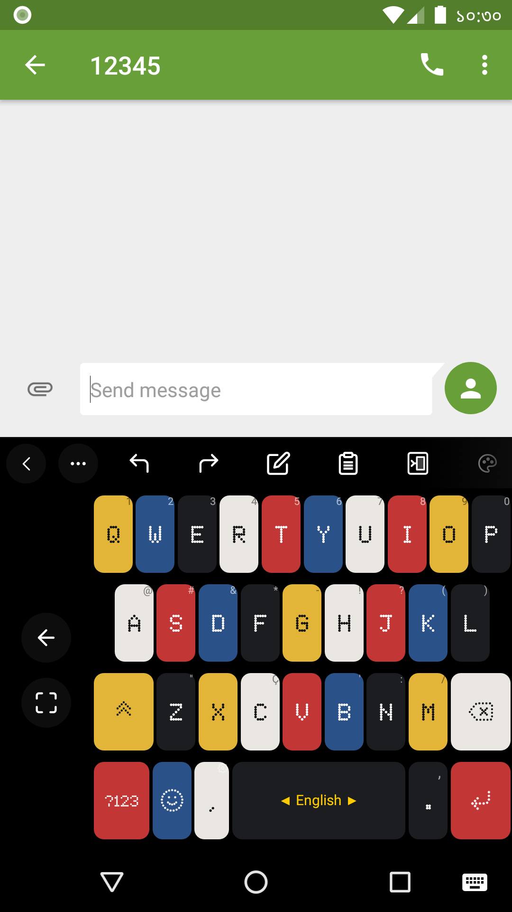
      <br />
      <b>One-Handed + Side Rail</b><br />
      <sub>1-tap Left/Right swap &amp; expand-full controls</sub>
    </td>
  </tr>
  <tr>
    <td align="center" width="25%">
      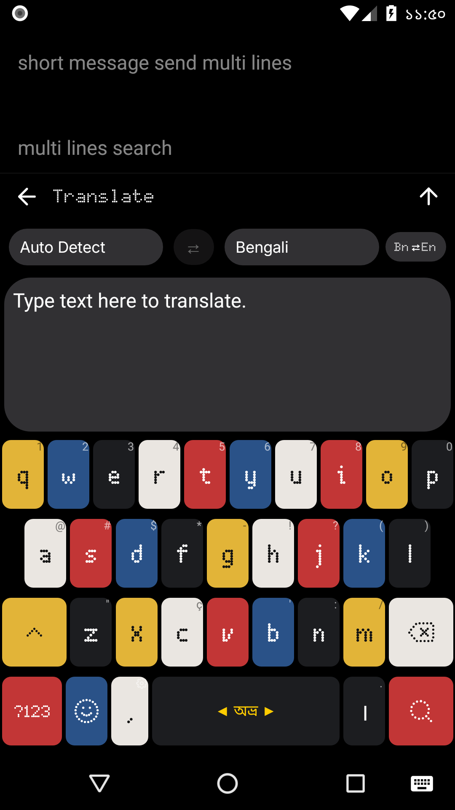 En quick toggle" width="210" />
      <br />
      <b>Inline Translator (Bn ⇄ En)</b><br />
      <sub>Auto Detect, quick Bn ⇄ En &amp; direct swap</sub>
    </td>
    <td align="center" width="25%">
      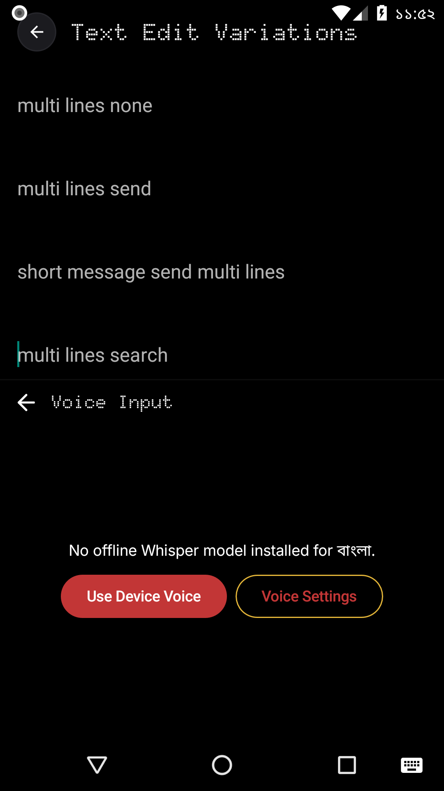
      <br />
      <b>Voice Input Panel</b><br />
      <sub>Offline Whisper or quick Device Voice</sub>
    </td>
    <td align="center" width="25%">
      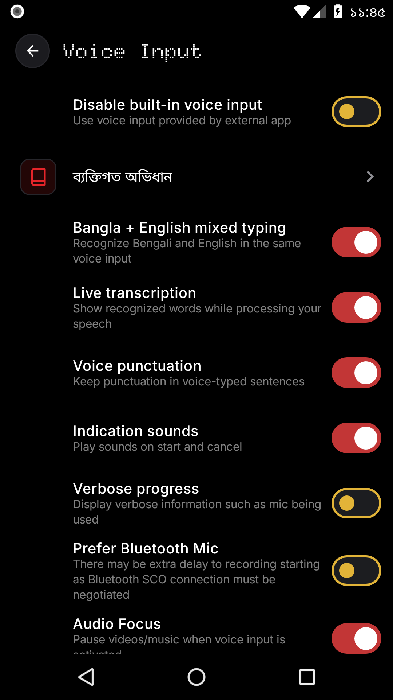
      <br />
      <b>Mixed Bangla + English Voice</b><br />
      <sub>Live transcription, punctuation &amp; BT mic</sub>
    </td>
    <td align="center" width="25%">
      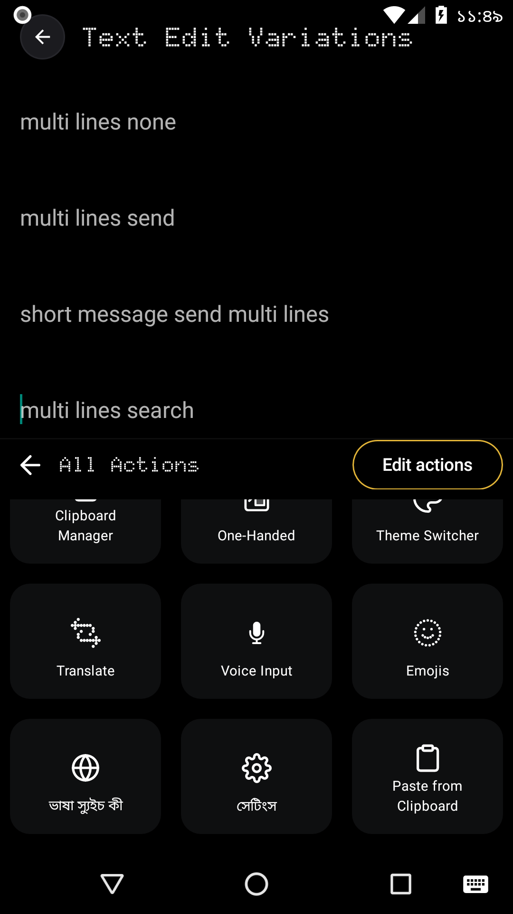
      <br />
      <b>All Actions (&hellip; Drawer)</b><br />
      <sub>Quick launch &amp; customizable toolbar order</sub>
    </td>
  </tr>
  <tr>
    <td align="center" width="25%">
      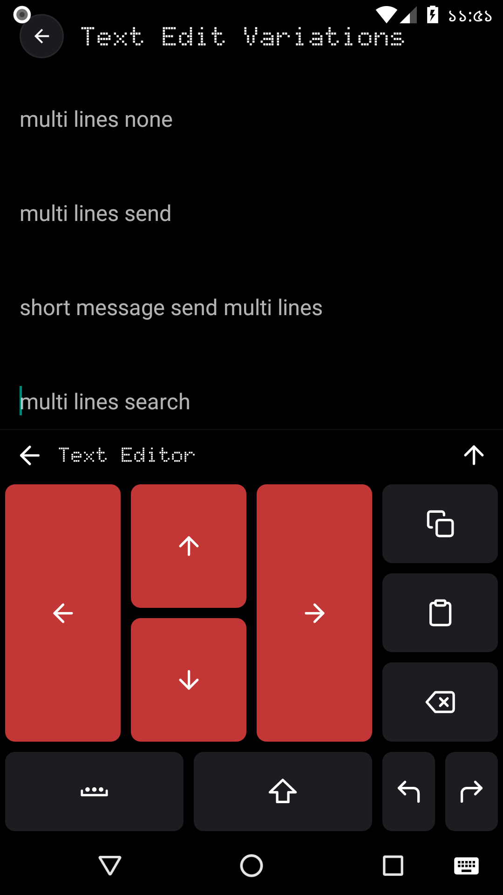
      <br />
      <b>Precision Text Editor</b><br />
      <sub>Directional cursor arrows, select &amp; copy/paste</sub>
    </td>
    <td align="center" width="25%">
      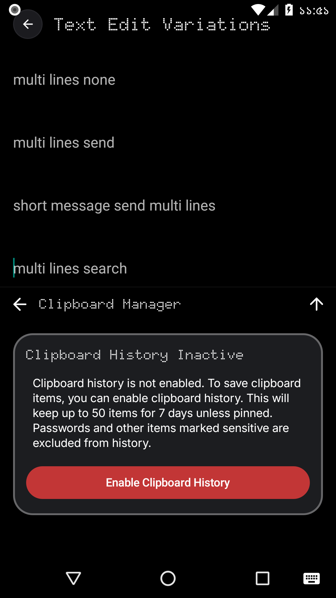
      <br />
      <b>Privacy-First Clipboard</b><br />
      <sub>50 items / 7 days, skips passwords</sub>
    </td>
    <td align="center" width="25%" colspan="2">
      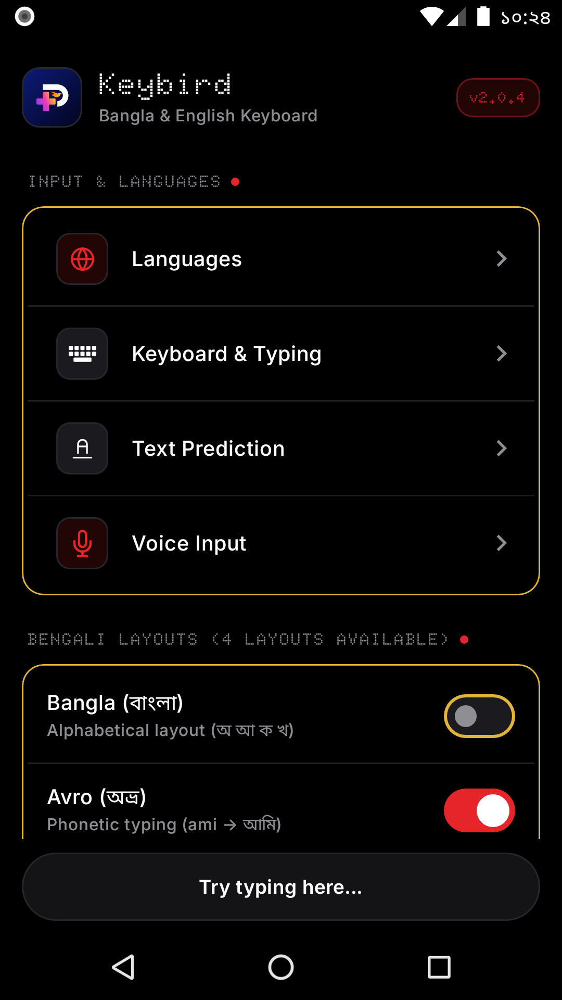
      <br />
      <b>Dot-Matrix Settings Home</b><br />
      <sub>Quick Bangla switches &amp; instant <i>"Try typing here..."</i> test box</sub>
    </td>
  </tr>
</table>

## Feature overview

### Typing, comfort, and layout controls

- **Option B ergonomic default portrait height:** Raises `config_default_keyboard_height` to `292.0dp` and `config_max_keyboard_height` to `55%p` so standard phones render a comfortable ~5.2–5.5 cm keyboard without clamping back down to ~243dp.
- **Single-bar inline ActionBar:** Merges the expandable shortcut strip cleanly inside the single `40dp` top bar—tapping the chevron switches inline between Suggestions/Pinned actions and Favorite shortcuts without adding a stacked second row.
- **One-Handed Mode (`off` / `right` / `left`):** Fixes settings-to-IME layout refreshes, syncs cleanly with Split Keyboard, adds a quick ActionBar shortcut (`OneHandedAction`), and renders an opposite-side `18%`-width control rail with one-tap Swap Left/Right and Expand Full Width controls.
- **Denser Emoji Picker (`1,979` emojis including Unicode 16.0):** Refines cell sizing (`35dp`) and compact category headers (`emoji_category.xml`) so ~60+ emojis fit comfortably on screen at once without trimming the full emoji catalog.
- **Bangla & English support:** Retains Avro, Probhat, Jatiyo, and Akkhor alongside English QWERTY with support for up to 5 active subtypes, stuck/repeating key touch fixes, and conservative Banglish/short-word auto-correction safeguards.

### Custom photo themes & Keybird Matte

- Includes **Keybird Matte** as well as AMOLED Nothing, Dynamic Auto/Light/Dark, and **Custom Photo** themes.
- Select a personal background image with document picker URI persistence, dim (`0–85%`), zoom (`1.0x–2.5x`), X/Y positioning, lightweight softening blur approximation, and saved preset management.

### Voice input settings & app identity

- Includes mixed Bangla-English voice recognition toggle, live transcription partial results, and voice punctuation preferences (dependent on available voice models and device environment).
- Features **Keybird** app branding, launcher adaptive/monochrome vector icons, and project links to GitHub & `@ismailq01appsstore` while preserving upstream provenance notices.

## Implementation and verification status

| Area | Current status |
|---|---|
| Keybird app-facing branding & launcher logo | Implemented |
| Option B portrait keyboard height (`292.0dp`, `55%p` max) | Implemented & unit-tested (`testStableDebugUnitTest`) |
| Single `40dp` inline ActionBar merge | Implemented |
| One-Handed Mode refresh, side control rail & quick toggle | Implemented & cycle helpers unit-tested |
| Denser Emoji picker layout (`35dp` cells, full 1,979 emojis) | Implemented & `EmojiAdversarialTest` / `EmojiIntegrationTest` checked |
| UpdateChecker `Keybird-*.apk` and legacy `iPlus-*.apk` matching | Implemented & unit-tested |
| Full on-device typing, voice, and UI interaction walkthrough | Requires physical Android device validation |
| Release signing / Play Store production signing | Not included in CI `stableDebug` universal APK |

For the detailed architecture and changelog notes, see [Feature and QA notes](docs/FEATURES.md).

## Build locally

On macOS/Linux:

```bash
./gradlew --no-daemon testStableDebugUnitTest assembleStableDebug
```

On Windows PowerShell:

```powershell
.\gradlew.bat --no-daemon testStableDebugUnitTest assembleStableDebug
```

Generated APKs are placed under `build/outputs/apk/stable/debug/` (with universal builds named `keybird-v2.0.4-stable-universal-debug.apk`). CI packages and publishes `Keybird-v<version>.apk` to GitHub Releases on push to `main`.

## Upstream source and legal notices

This project is based on the publicly available source of [Orbit Board](https://github.com/fahitakrim/Orbit-Board) and AOSP `LatinIME`. Copyright notices, Apache-2.0 license terms, the [NOTICE](NOTICE) file, and [LICENSE.md](LICENSE.md) remain intact.

## Official links

- Telegram channel: https://t.me/ismailq01appsstore
- GitHub repository: https://github.com/iplus009/iplus-keboard
