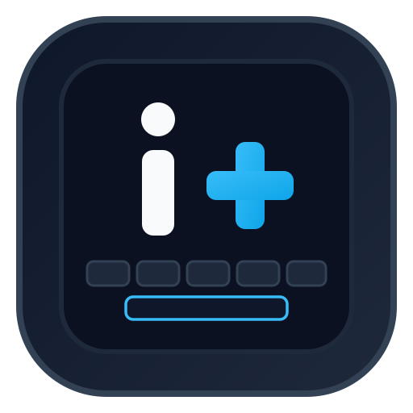

# iPlus Keyboard

<p align="center">
  
</p>


**iPlus Keyboard** is an Android keyboard project focused on Bangla and English input, a customizable typing experience, and a cleaner iPlus-branded app interface. This repository develops the iPlus experience on top of the available open-source keyboard engine while preserving upstream licensing and attribution.

> **Development status:** The current implementation branch has a successful GitHub Actions stable-debug build. The APK has not yet completed physical-device regression testing, so build success should not be interpreted as a full feature or release-readiness certification.

## Project at a glance

| Item | Details |
|---|---|
| Platform | Android |
| App name | iPlus Keyboard |
| Main input focus | Bangla and English |
| Source branch | `work/iplus-keyboard-implementation` |
| Application ID | Existing upstream ID retained for update compatibility |
| Build channel | GitHub Actions — stable debug APK |
| Official Telegram | [@ismailq01appsstore](https://t.me/ismailq01appsstore) |

## Feature overview

### Typing and language support

- Retains the keyboard engine's available Bangla and English input capabilities.
- Supports the project’s Bangla layout set: Avro, Probhat, Jatiyo and Akkhor, alongside English QWERTY where provided by the installed subtype resources.
- Raises the active-keyboard selection limit to **five**, allowing four Bangla layouts plus English to be selected together.
- Updates the language-selection UI to use the shared limit and clearer wording.

### Custom photo themes

The Custom Photo theme can use an image selected from the device:

- Select a personal image through Android's document picker.
- Persist image access where Android permits it.
- Adjust background dim, zoom and horizontal/vertical position.
- Adjust a softening/blur-style effect.
- Save multiple photo-theme presets.
- Apply, rename and delete saved presets.
- Reset custom photo adjustments.

The blur-style effect currently uses bitmap downscaling/upscaling as a lightweight softening approximation; it is not a true Gaussian blur. Existing built-in themes are intended to remain available alongside the added custom-photo options.

### Voice input settings

- Adds a setting to include English alongside the current language for mixed-language voice recognition.
- Adds a live-transcription / inline partial-result toggle.
- Adds a voice-punctuation preference.
- Connects these preferences to the existing voice-input action and recognition configuration.

Recognition quality and mixed-language behavior depend on the available voice model, installed language support and device environment. These behaviors still require on-device testing.

### Reliability and maintenance

- Update-check failures no longer produce a misleading “Already on latest version” result; the checker reports failure and clears the stale update state.
- Custom-photo selection now checks whether persistent URI permission was actually granted before saving the selected image.
- Adds an accessibility description to the custom-photo selection control.
- Enables the Android spell-checker service in the app configuration.
- Retains the existing application ID to avoid unnecessarily breaking compatibility with installations based on the upstream package identity.

### App identity and project links

- Uses **iPlus Keyboard** as the app-facing name and branding.
- Includes the project’s GitHub and official Telegram links in the app's developer/details area.
- Keeps required upstream and third-party legal attribution in the appropriate notices and license files rather than removing legally required credits.

## Implementation and verification status

The following table distinguishes code changes from behavior that still needs device validation.

| Area | Current status |
|---|---|
| iPlus app name and app-facing identity | Implemented |
| GitHub and Telegram project links | Implemented |
| Four Bangla layouts + English selection limit | Limit/UI updated; actual layout availability depends on included subtype resources |
| Existing built-in themes | Retained in the current implementation |
| Custom photo background | Existing feature retained and permission handling improved |
| Photo dim, zoom and X/Y positioning | Implemented in code |
| Blur-style softening control | Implemented in code; approximation, not Gaussian blur |
| Save/apply/rename/delete photo presets | Implemented in code |
| Mixed Bangla-English voice setting | Implemented in code; model/device validation pending |
| Live transcription setting | Implemented in code; device validation pending |
| Voice punctuation setting | Implemented in code; device validation pending |
| Update-check failure handling | Fixed in code |
| Android spell-checker service | Enabled in app configuration; device validation pending |
| Full typing, prediction and autocorrection regression | Not yet fully verified |
| Physical-device compatibility and performance | Not yet verified |
| Release signing / production release | Not included in the debug build |

For the detailed implementation notes and test checklist, see [Feature and QA notes](docs/FEATURES.md).

## Latest automated build

The implementation branch's latest recorded workflow run completed successfully:

- Workflow run: [Build #65](https://github.com/iplus009/iplus-keboard/actions/runs/43300979683)
- Commit: `54c2d3ef3137615cbe49a98b7e2bd0e2693380b1`
- Result: **Success**
- Artifact: `iplus-keyboard-stable-debug`

Open the workflow run and download the APK from its **Artifacts** section. The workflow emitted a Node.js 20 deprecation warning for an action running under Node.js 24; that warning did not cause this recorded run to fail.

**Important:** This is a debug APK artifact. It is not a signed production release, and a successful CI build does not replace installation, typing, voice, theme, permission and upgrade tests on real devices.

## Build locally

This repository includes the Gradle wrapper. On a machine with a compatible JDK and Android SDK installed, run:

```bash
./gradlew assembleDebug
```

On Windows:

```powershell
.\gradlew.bat assembleDebug
```

The debug APK is normally produced under the Android app module's `build/outputs/apk/debug/` directory. Exact output paths can vary with the Gradle module configuration.

## Upstream source and legal notices

This project is based on the publicly available source of [Orbit Board](https://github.com/fahitakrim/Orbit-Board). The keyboard engine and third-party components retain their upstream provenance. Copyright notices, Apache-2.0 license terms, the `NOTICE` file and third-party attributions must remain available.

The upstream public repository describes source availability through v1.0.8, with later releases distributed as binaries from private development. This project is based on the available public source and does not claim to include private source code for later upstream releases.

See [LICENSE.md](LICENSE.md) and [NOTICE](NOTICE) for applicable notices.

## Official links

- Telegram channel: https://t.me/ismailq01appsstore
- GitHub repository: https://github.com/iplus009/iplus-keboard

## Contributing and issue reports

Please include the device model, Android version, app build/commit, steps to reproduce and relevant logs when reporting a bug. Do not publish signing keys, passwords, API keys or private user data in issues or commits.
